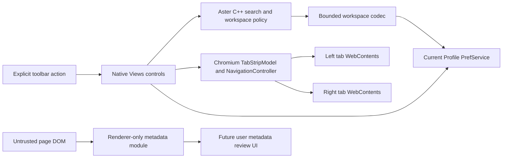

# Architecture

Aster is a small maintained overlay on an exact official Chromium revision. The repository does not vendor a partial rendering engine or copy Chromium's large history. A dedicated checkout owns all upstream source and DEPS. Aster adds `//aster` and native adapter files and patches three upstream files to register the pref, controls, GN sources and tests.

The diagram's metadata review UI is future work. There is no renderer-to-browser metadata bridge in this milestone.

## Modules and boundaries

1. **Browser UI:** upstream Views/browser services; two small native toolbar controls. New bubble code separates `BubbleDialogDelegate` from its owned content view and uses a weak browser reference. A button owns its widget and delegate in destruction order.
2. **Workspace Manager:** pure C++ data and validation. Profile identity is not a user-supplied path or arbitrary identifier crossing a renderer boundary. The adapter obtains `browser->GetProfile()` and uses its registered, non-sync preference.
3. **Multi-Search:** templates are HTTPS-only, exactly one escaped query placeholder, no credentials/fragments/control characters. The native boundary also validates with GURL. No search scraping. Default engines are Google/DuckDuckGo. Existing native split tabs provide actual WebContents and normal delegates.
4. **Citation Engine:** DOM extraction yields untrusted plain metadata and a missing-field list. Exports sanitize delimiters and prevent injected RIS records. A future Mojo bridge must validate lengths/schema/origin and request explicit user review. No fabricated values or website-supplied code runs in the browser process.
5. **Research Library:** planned profile-keyed local database with folders, tags, annotations, CSL-JSON records and versioned migrations.
6. **IB Study Tools:** planned local MYP/DP records, flexible criteria and evidence-oriented learning features, separate from citation processing.
7. **Business Tools:** planned notes/tasks/agendas built on common local records. Personal/business cookie isolation requires separate Chromium Profiles, not just workspace labels.
8. **Data Analysis:** planned sandboxed parsing/worker execution, import preview and user-selected table extraction. Never parse arbitrary datasets in privileged UI/browser code.
9. **AI:** planned optional request broker, per-request preview and consent, OS credential storage, and explicit provider/API configuration. No current implementation.
10. **Settings:** Chromium PrefService for small profile-local state; current workspace codec uses bounded base64 storage. A dedicated service and migration to database-backed large collections precedes scale-up.
11. **Release:** core tests on hosted runners; full browser builds on provisioned native runners. Platform identity/signing/updaters must be finished before distributing installers.

## Persistence contract

`ASTERWS1` is the schema magic. Little-endian 32-bit lengths/counts precede UTF-8 strings. Limits: 4 MiB encoded input, 64 workspaces, 16 sessions/workspace, 256 tabs/session, 512 bookmarks/workspace and 4,096 total tab/bookmark records. Unknown versions, truncated/trailing data, duplicate identifiers/session names, out-of-range active indices and unsafe restore URLs are rejected. Corrupt native preferences are retained and reported instead of silently overwritten.

The codec rejects off-the-record serialization. The adapter also denies reading or writing regular catalogs from private profiles. Writes load the latest profile catalog before modifying one session, avoiding a stale per-bubble cache overwriting other windows' updates. Full native concurrency/lifecycle validation is still required.

## Upstream maintenance

Keep engine/network/sandbox code unchanged. `apply_overlay.py` requires the exact commit, hashes pristine patch inputs, checks the patch before writing, refuses unknown destination files, and verifies an installed manifest on rerun. Use a fresh pinned checkout when changing the overlay or upstream version; never force-apply against a moving branch.

For an upgrade: resolve current stable, update the commit pin, review APIs, refresh the patch and hashes, run the source check and core tests, then GN check, compile, native/browser tests, security and platform acceptance tests. Do not publish an old security pin merely because its standalone tests still pass.
